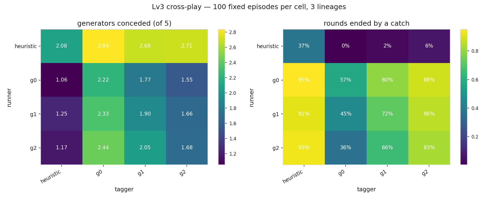
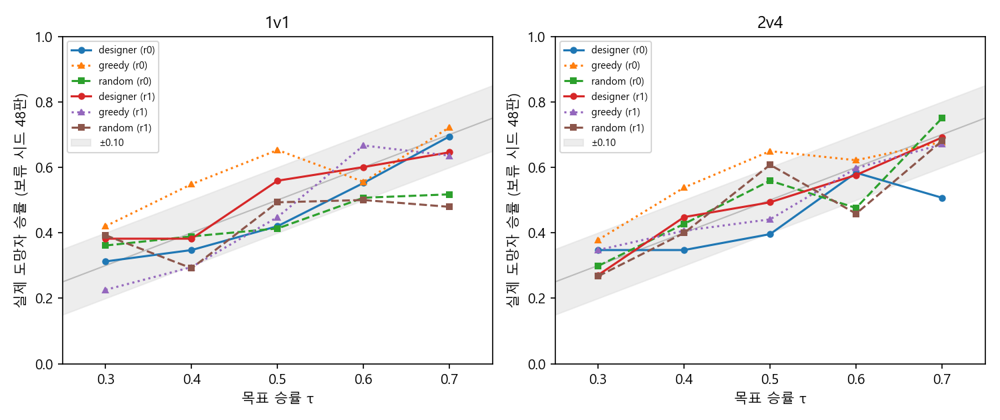
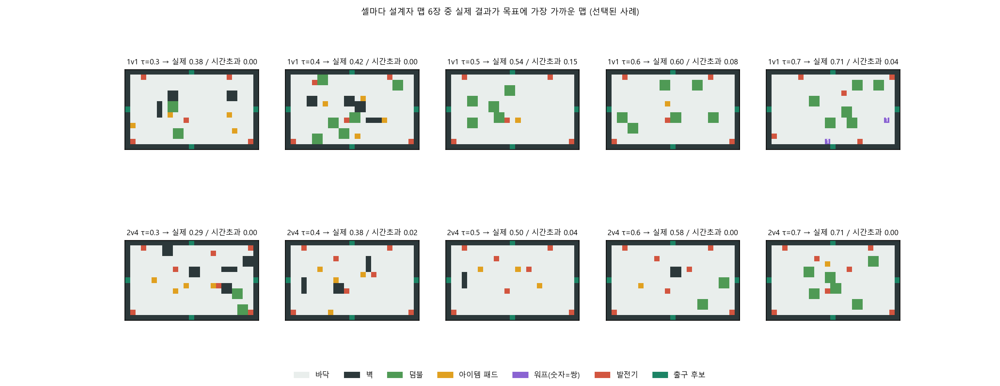

# 2D 술래잡기·숨바꼭질 강화학습: 플레이어 학습에서 맵 학습까지

**DSL 26-2 Modeling — RL Project**  
15기 배연욱 (팀장) · 15기 김시원 · 15기 현승원 · 16기 김현준 · 16기 전유하

---

## Project Overview

정보도 속도도 비대칭인 2D 술래잡기 게임을 직접 구현하고, 같은 엔진 위에서 강화학습(PPO)을 두 방향으로 적용한 프로젝트

| 파트 | 학습 대상 | 질문 | 스터디 |
|---|---|---|---|
| **중간** | 플레이어 | 어떻게 학습시켜야 플레이어 정책이 이 게임을 배우는가? | A 커리큘럼 · B 크로스플레이 · C 안개 ablation · D 사전등록 재실행 |
| **최종** | 맵 | 플레이어를 고정하고 맵만 바꿔서 승률을 50:50(또는 목표 τ)에 맞출 수 있는가? | E 편집 MDP · F PPO 맵 설계자 |

- **중간 → 최종 연결:** A–D의 도망자 승률은 거의 항상 바닥. 그 바닥이 정책 탓인지 맵·규칙 탓인지 분리하려고 최종에서 학습 대상을 플레이어에서 맵으로 뒤집음
- **공통 방법론:** 랜덤·휴리스틱 기준선(앵커)을 먼저 재고, 관찰로 끝내지 않고 원인을 측정으로 특정, 틀린 가설도 기록

발표 자료: [중간발표](presentation/2026-2%20Reinforcement%20Learning%20중간발표자료.pdf) · [최종발표](presentation/2026-2%20Reinforcement%20Learning%20최종발표자료.pdf)

### 공통 엔진 — 게임 규칙

- **술래(빨강):** 부채꼴 시야 120°×7타일, 200 px/s. 도망자를 잡거나 제한 시간 120초를 버티면 승리
- **도망자(파랑):** 시야 210°×6타일, 240 px/s로 술래보다 빠름. 발전기를 채널링(제자리에서 일정 시간 수리)으로 켜서 탈출구를 열고 빠져나가면 승리
- **맵:** 문으로 이어진 방 구조(Mansion). 커리큘럼 레벨은 최종 맵 Lv3 한 장에서 기능만 끈 파생판 — Lv1 순수 술래잡기(장애물·발전기 없음), Lv2 발전기·탈출구 추가, Lv3 장애물까지 포함
- **RL 인터페이스:** 관측 46차원(시야에 보이는 정보만, 시야 밖은 마지막 목격 위치·경과 시간), 행동 Discrete(9) = 정지 + 8방향, 보상 = 승패 ±10 + 미션 진행 + 접근 shaping(승패 외 중간 보상)
- **공용 평가:** Lv3 · 고정 시드 200판 · 아이템 OFF · 상대는 휴리스틱(`ChasePolicy` / `FleePolicy`)
- 엔진은 순수 파이썬 시뮬레이션(`tag_game/`), 학습은 Stable-Baselines3 PPO. 이후 추가 기능(규칙 옵션·스킬·신규 맵)은 전부 기본 꺼짐이고 궤적 해시로 기존 동작과 비트 단위 동일함을 확인

---

## Pipeline

```
                         tag_game/  (공통 엔진 · 휴리스틱 · 맵 13종)
                                       │
         ┌─────────────────────────────┴─────────────────────────────┐
  [중간] 플레이어 학습                                       [최종] 맵 학습
  configs/*.json → train.py (PPO)                            E  mapstudy/  기존 맵 편집 MDP
        │          evaluate.py (Lv3·200판)                       balance → baselines / train → evaluate → analyze
        │          analyze.py (순열검정·곡선)                F  mapgen/   빈 공터 설계 MDP
  A  scripts/run_*.sh        → results/                          gen_data → surrogate → train_designer → validate → analyze
  D  scripts/v2/run_*.sh     → results/v2/
  B  crossplay/ run_all → evaluate_all → analyze/plots → crossplay/results/
  C  studies/fog-ablation/ (별도 엔진 계열, 결과 보존)
```

| 단계 | 스크립트 | 입력 | 출력 |
|---|---|---|---|
| A·D 학습 | `train.py` (스크립트가 단계별 호출) | `configs/`, `configs/v2/` | `runs/` (모델, git 제외) |
| A·D 평가 | `evaluate.py` | 체크포인트 | `results/`, `results/v2/` |
| A·D 통계 | `analyze.py` | 결과 JSON | 표·순열검정·학습곡선 |
| B 학습·평가 | `crossplay/run_all.py` → `evaluate_all.py` | 세대별 상대 | `crossplay/results/matrix.json` |
| B 분석 | `crossplay/analyze.py`, `plots.py`, `diagnose.py` | 매치업 격자 | 표·그림·보상↔관측 진단 |
| E 탐색·학습 | `mapstudy/baselines.py`, `train.py` | 등록 맵 13종 | `mapstudy/results/` |
| E 재채점·검정 | `mapstudy/evaluate.py` → `analyze.py` | arm별 최종 맵 | `final.json` → 표·검정 |
| F 설계자 | `mapgen/surrogate.py` → `train_designer.py` → `validate.py` | 랜덤 구성 맵 1,231장 | `mapgen/results/` |

### 중간 설계 (A–D)

- **A. 커리큘럼 vs 직접학습:** 커리큘럼 학습(Lv1 393,216 → Lv2 589,824 → Lv3 1,015,808 스텝, 가중치 이어받기) vs 직접학습(처음부터 Lv3 1,998,848 스텝). 예산을 스텝 단위까지 동일하게 맞춤. 두 arm(비교 조건)을 12런 vs 3런으로 비교, 예산이 같은 세 지점(early = Lv1 끝, mid = Lv2 끝, final)에서 평가
- **B. 크로스플레이:** 학습된 정책끼리 맞붙인 4×4 격자(휴리스틱 + 세대 g0→g2, 세대마다 직전 세대 상대를 상대로 학습). 시드 3개 계보(lineage, 시드별 세대 사슬) × 2역할, 칸당 100판
- **C. 안개(fog) ablation:** 시야 반경 7단계(80 px ~ 1200 px + fog off) × 3시드 × 2역할 + 기억 arm(마지막 목격 위치를 기억하는 시간 0.5/4/12초) 12런 = 54런, 런당 100만 스텝. 안개를 "시야 거리 제한"과 "벽 차폐(벽이 시야를 가림)" 두 요소로 분해. 원본 프로토타입에서 갈라진 별도 엔진 계열(원형 시야, 78차원 관측)에서 수행
- **D. 사전등록 재실행:** A의 질문을 B가 고친 보상·규칙(발전기 5개 중 3개, 탈출구 3곳을 해금 순간 추첨, 랜덤 스폰, 연속 퍼텐셜 보상 = 목표까지의 거리 변화를 타일 단위가 아니라 연속값으로 주는 shaping)에서 다시 물음. 결과 전에 가설·분석 계획 고정([`docs/study-v2-protocol.md`](docs/study-v2-protocol.md)). D-1은 그 조건의 커리큘럼 vs 직접학습 재비교(9런 vs 6런), D-2는 학습 없이 같은 체크포인트를 발전기 랜덤 배치에서 재채점해 "배치를 외웠는가"를 측정

### 최종 설계 (E–F)

- **E. 편집 MDP:** 휴리스틱 쌍을 고정하고 기존 맵을 고치는 정책 학습. 커서 기반 행동 9개(이동 4 · 벽 토글 · 발전기/탈출구/스폰 이동 · 무편집), 관측 302차원, 에피소드당 40편집, 모든 편집이 `GridMap` 연산자를 통과해 깨진 맵 제출 불가
  - 주지표: 맵별 `balance_error` = |도망자 승률 − 0.5| (이하 |err|). 승률의 평균은 지표로 쓰지 않음(부호 있는 편차가 상쇄됨)
  - 기준선 arm 5종(anchor · random · mutate · hillclimb · anneal) vs `ppo` · `ppo_surrogate`(기하 지표 → 승률 대리모형 사용), arm·시드당 실제 시뮬레이션 30회, 시드 4개
  - 두 단계 채점: search(24라운드·60초)로 탐색, report(240라운드·120초)로만 결과 인용
  - 사전등록 가설: H1 ppo < random·mutate / H2 ppo < hillclimb·anneal / H3 \|err\|와 유의하게 상관하는 기하 지표 ≥ 1개(Holm 보정)
- **F. PPO 맵 설계자:** 25×15 빈 캔버스에 구조물 8종(벽 · 덤불 · 아이템 패드 · 워프 · 발전기 …)을 놓아 목표 승률 τ(0.3–0.7)와 시간초과 ≤ 20%를 맞춤. 모드 1v1·2v4(팀 엔진 `TeamWorld`), 보상 = CNN 대리모형 앙상블이 예측한 \|승률 − τ\|와 시간초과 초과분의 편집당 감소량(퍼텐셜 기반), 셀프 피드백 1라운드

---

## Output / Evaluation

### A. 커리큘럼 vs 직접학습 — 커리큘럼이 hard exploration을 우회

| 지점 | 지표 | 커리큘럼 (n=12) | 직접학습 (n=3) | 순열검정 p |
|---|---|:---:|:---:|:---:|
| mid (983,040 스텝) | 발전기 수 | 0.65 | 0.00 | 0.0154 |
| **final (1,998,848 스텝)** | **발전기 수** | **1.28** | **0.23** | **0.0022** |

- 승률은 15런 전부 0%(휴리스틱 도망자도 0%) → 사전 규칙대로 라운드당 완료한 발전기 수(`avg_missions`)가 주지표. 앵커: 랜덤 0.03 / 휴리스틱 2.25
- 순열검정(런 단위로 arm 라벨을 섞는 검정) p = 0.0022는 12 vs 3 설계가 낼 수 있는 최소값. 런을 하나씩 빼도 부호 불변, 매치드 에피소드 36/36 커리큘럼 우세
- mid는 커리큘럼이 Lv3를 한 번도 보지 않은 시점 → Lv1·Lv2에서 배운 것이 Lv3로 전이됨
- 직접학습은 2M 스텝 동안 "발전기 수리"를 사실상 발견하지 못함(hard exploration: 첫 보상까지의 행동열이 길어 무작위 탐색으로는 거의 못 찾는 문제). 단 이 결론은 이 보상 설계 안에서만 성립 → D에서 사라짐

### B. 크로스플레이 — 진동의 원인은 여섯 겹, 고치자 군비경쟁

"PPO가 제자리에서 진동함"의 원인을 하나씩 측정으로 분리

| 층 | 측정 | 수정 후 |
|---|---|---|
| (a) 정지가 공짜 | 움직이지 않는 술래의 할인 리턴(미래 보상을 할인해 더한 값) +2.86 | 스텝당 시간 비용 → −20.10 |
| (b) shaping 타일 양자화 | 움직인 스텝의 70.2%(도망자)가 보상 정확히 0 | 연속 퍼텐셜(거리 변화) → 13.3% |
| (c) 벽 끼임 무시 | `stuck_frac` 0.24 | 막힘 페널티 → 0.05 |
| (d) 보상 스케일 (틀린 가설) | 가중치 7배에도 변화 없음 — PPO가 어드밴티지를 정규화 | 되돌림 |
| (e) 보상↔관측 불일치 | 술래 행동과 경로 나침반(관측에 든 목표 방향)의 일치율 3.9%(우연 12.5%보다 낮음) | cos +0.62 · 일치율 31% |
| (f) 술래가 보이지 않음 | 잠복 규칙(술래가 기다릴 위치 선택) 4종이 소수점까지 같은 결과 | 도망자 스폰에 잠복 → 상대 승률 100% → 0% |

- **규칙 수정:** 발전기 5/5 + 탈출구 4곳에서는 도망자 승 0%(잡힘 56% · 시간초과 44%) → 발전기 3/5 + 탈출구 랜덤 3곳에서 40%(잡힘 32% · 시간초과 28%)
- **철회한 헤드라인:** 고정 스폰에서 "학습된 술래가 휴리스틱보다 강함"(포획 52% vs 34%)은 시작 위치 암기였음. 랜덤 스폰에서는 PPO 술래의 포획률 0–7%(휴리스틱 37%)

| 도망자 \ 술래 | 휴리스틱 | g0 | g1 | g2 |
|---|:---:|:---:|:---:|:---:|
| 휴리스틱 | 28% | 77% | 72% | 71% |
| PPO g0 | 5% | **45%** | 21% | 10% |
| PPO g1 | 8% | **55%** | 27% | 13% |
| PPO g2 | 7% | **65%** | 35% | **15%** |

- 표는 도망자 승률(계보 3개 평균). 술래를 g0으로 고정하면 도망자가 세대마다 45 → 55 → 65%, 도망자를 g0으로 고정하면 술래 세대가 오를수록 도망자 승률이 45 → 21 → 10%로 하락(술래가 세대마다 강해짐) — 한쪽을 고정하면 다른 쪽이 세대마다 강해짐
- 처음 보는 계보 상대(18.3%)와 함께 학습한 상대(15.3%)의 차이 없음 → 특정 상대가 아니라 역할을 학습. 계보가 3개뿐이라 추세는 방향으로만 읽음
- 행동 복제·DAgger로 잰 64×64 MLP의 휴리스틱 도망자 모방 상한 89.9%(512×512×512에서 97.1%) → 모든 학습에 쓴 기본 64×64 네트워크의 용량이 병목일 가능성



### C. 안개 ablation — 안개의 효과는 사실상 벽 차폐

| 시야 반경 | 80 px | 220 px (기본) | 1200 px |
|---|:---:|:---:|:---:|
| 도망자 승률, 거리 제한 + 벽 차폐 | 22.5% | 23.3% | 18.3% |
| 도망자 승률, 거리 제한만 | 23.3% | **2.5%** | 0.0% |

- 휴리스틱 대 휴리스틱, 칸당 120판. 벽 차폐가 있으면 15배 범위에서 반경은 결과를 거의 바꾸지 못함, 차폐를 빼면 반경이 승부를 결정
- **PPO 술래는 시야가 넓을수록 오히려 약함:** 승률 38.1%(80 px) → 25.9%(1200 px), Spearman ρ = −0.536, p = 0.023. 단 넓은 arm은 100만 스텝에서 아직 미수렴 → 점근 성능이 아니라 표본 효율의 결과로 읽음
- **도망자는 모든 arm·시드에서 승률 0%:** 안개가 짙을수록 숨기만 늘어 80 px에서 62.6초를 버티고도 발전기 0.00개
- **전이:** 짙은 안개(80 px)에서 배운 술래가 가장 범용적(다른 반경 포함 평균 30%), fog off에서 배운 술래가 가장 특화적(평균 19%)


### D. 사전등록 재실행 — A의 결과가 재현되지 않음

| 지점 | 지표 | 커리큘럼 (n=9) | 직접학습 (n=6) | 순열검정 p |
|---|---|:---:|:---:|:---:|
| early | 발전기 수 | 0.068 | 0.639 | 0.0002 |
| mid | 발전기 수 | 0.508 | 0.882 | **0.0020** |
| **final** | **승률 (주지표)** | **0.027** | **0.046** | **0.4096** |
| final | 발전기 수 | 1.078 | 1.085 | 0.9433 |

- 9 vs 6 순열검정의 최소 p는 0.0002 → final의 큰 p값은 검정력 부족이 아니라 실제 무효과. 런을 하나 빼면 부호가 뒤집혀 승자를 말할 수 없음
- 중반까지는 오히려 직접학습이 유의하게 앞섬. 갈라진 쪽은 커리큘럼이 아니라 대조군 — 직접학습이 A의 0.23에서 1.085로 올라옴 → A에서 커리큘럼이 산 것은 hard exploration 우회였고, B의 연속 퍼텐셜 보상이 그 장벽을 대신 치움. 보상과 규칙을 동시에 바꿨으므로 "보상이 원인"까지는 확정 불가
- **D-2 (배치 암기):** 승률 기준(초과 하락 ≳ 10 pp)은 원점수 2.7%·4.6%보다 커서 도달 불가 → "외우지 않았음"이 아니라 "이 지표로는 답할 수 없었음". 발전기 수로는 휴리스틱 앵커(+0.060) 대비 초과 하락이 커리큘럼 +0.292(Holm p = 0.0158), 직접학습 +0.222(Holm p = 0.0486)로 두 arm 다 유의 — 임계값이 없는 지표라 효과크기로만 읽음

### 최종 출발점 — 등록된 7개 맵 (발전기 3개를 켜야 탈출구가 열리는 절대 규칙 · 60초 · 맵당 24판)

| 맵 | 도망자 승률 | \|err\| |
|---|:---:|:---:|
| Lv3 | 0.333 | 0.167 |
| Lv2 | 0.083 | 0.417 |
| Lv1 · Arena · Corridors · Pillars · Mansion | 0.000 | 0.500 |

- 7개 중 5개가 승률 0.000. 발전기 규칙을 맵이 선언한 수의 분수로 바꾸자 0.000인 맵이 13개 중 Lv1 하나로 감소 → A–D 승률 바닥의 일부는 정책이 아니라 규칙 탓

### E. 편집 MDP — 탐색은 균형 맵을 찾지만, RL은 담금질보다 못함

| arm | 중위 \|err\| (report 단계) |
|---|:---:|
| `anneal` (담금질) | **0.079** |
| `ppo` | 0.119 |
| `ppo_surrogate` (대리 3,600 에피소드) | 0.121 |
| `hillclimb` | 0.204 |
| `mutate` | 0.215 |
| `random` | 0.233 |

- **최고 맵:** \|err\| **0.021**, 도망자 승률 0.521 (95% CI [0.458, 0.583]) — 0.5와 통계적으로 구별 안 됨. 단 `hillclimb` 시드 0(Mansion 출발)의 결과로 26개 arm·시드 최종물 중 최소값, 스킬 OFF 측정
- **H3 (상관) 성립:** 기하 지표 14개 중 8개가 가족 수준(원본 맵과 그 변이를 한 묶음으로 본) 검정·Holm 보정 후 생존, \|ρ\| 0.35–0.59 (`openness_std` +0.591 · `station_spread` −0.551 · `sight_mean` +0.548) — 시야가 길면 술래 유리, 발전기가 흩어지면 균형에 근접. 단 누출 없는 교차검증(같은 가족이 학습·검증 양쪽에 갈리지 않게 나눔) R² 0.07–0.24로 예측력은 약함
- **H1:** 방향만 맞고 유의하지 않음 (p 0.11 / 0.14). **H2 실패:** 어느 쌍도 유의하지 않음(최소 p 0.114)
- **H2 실패 원인:** ① 예산 정의 결함 — "채점 30회"가 담금질에는 판정 30회, PPO에는 30 에피소드. 학습된 정책이 hold-out 맵 6개에서 편집 예산 12회 중 실제로 편집한 횟수 [1,1,0,0,1,0] ② 보상 버그 — 편집마다 확정적으로 깎이는 비용 0.224에 비해 에피소드 끝 균형 보상은 표준오차 1.02로 잡음이 커 "편집하지 말 것"만 학습, 수정 후 편집 [7,8,11,3,7,10] ③ 실제 보상 4.6배 예산에서도 \|err\| 평탄(ρ −0.018 / −0.007) → 병목은 신용 배분(어느 편집이 결과에 기여했는지 가리는 문제 — 편집 40회를 스칼라 하나로 평가)
- **스킬(LoL식 액티브 4종, 기본 꺼짐):** 평균 \|err\| 스킬 OFF 0.188 → 설계 그대로 0.360(악화) → `PLAYABLE_TUNING`(스킬 ON 기본 튜닝) 0.141 → `BALANCED_TUNING` 0.078(술래 스킬 `destiny`의 게이트, 즉 전역 시야 후 순간이동을 쓸 수 없게 만들어 얻은 값). 이동 봉쇄·전역 시야 스킬을 술래가 쥐면 0.372, 도망자가 쥐면 0.135

### F. PPO 맵 설계자 (보류 시드 실제 대전, 방법·모드당 맵 30장, w = 실제 도망자 승률)

| 방법 | \|w − τ\| 1v1 | \|w − τ\| 2v4 | 시간초과 위반 1v1 |
|---|:---:|:---:|:---:|
| 설계자 (PPO) | 0.099 | 0.097 | **7%** |
| 그리디 (대리모형 탐색) | 0.093 | **0.069** | 30% |
| 랜덤 탐색 | 0.157 | 0.096 | 30% |



- 맵당 48판의 측정 잡음만으로 ≈ 0.06의 오차. 1v1은 설계자가 랜덤보다 유의하게 나음(p = 0.017), 그리디와는 차이 없음(p = 0.57). 2v4는 그리디가 최선
- 설계자의 강점은 정확도가 아니라 제약 준수(1v1 위반 7% vs 30%)와 추론 비용(평균 9.3회 편집 × 신경망 1회 vs 그리디는 편집마다 후보 48개 채점)
- **구조 다이얼** (실제 승률과의 ρ, 1v1 / 2v4): 내부 벽 −0.53 / −0.81 · 아이템 패드 −0.68 / −0.68 → 술래 유리, 덤불 +0.45 / +0.40 · 순환로 +0.56 / +0.81 → 도망자 유리. 도망자 2명 추가마다 승률 약 +0.25, 맵의 상대 순서는 유지(ρ = +0.63)



### 결론

> **중간:** 커리큘럼의 이득(A)은 보상 설계에 조건부였고, 사전등록 재실행(D)에서 사라짐. "PPO가 못 배운다"는 증상의 실제 원인은 보상·관측·규칙의 설계 결함(B)과 벽 차폐가 만든 숨기 전략(C)이었음  
> **최종:** 게임의 균형은 플레이어만이 아니라 맵·규칙·스킬에도 달려 있음 — 탐색이 0.5와 구별되지 않는 맵을 찾아냄. 단 RL이 맞는 도구인지는 과제마다 다름: E에서는 PPO가 담금질에 못 미치고, F에서는 정확도가 그리디와 비슷하며 강점은 제약 준수와 추론 비용  
> **공통 교훈:** 앵커를 먼저 재고, 사전등록하고, 관찰로 끝내지 말고 원인을 측정할 것 — 이 셋이 A의 헤드라인을 뒤집고 E의 실패 원인을 특정함

모든 "균형"은 이 휴리스틱 쌍에 대한 균형임. 세부와 한계는 각 디렉터리 문서([`crossplay/WRITEUP.md`](crossplay/WRITEUP.md) · [`studies/fog-ablation/RESULTS.md`](studies/fog-ablation/RESULTS.md) · [`docs/study-e-results.md`](docs/study-e-results.md) · [`mapgen/REPORT.md`](mapgen/REPORT.md))

---

## Repository Structure

```
26-2_DSL_Modeling_RL/
├── main.py                  # pygame 게임 클라이언트 (학습 모델 있으면 자동 로드, 없으면 휴리스틱)
├── tag_game/                # 공통 엔진: world · agents · maps · levels · rl_env · skills · gridmap · paths
│
├── train.py · evaluate.py · analyze.py   # [A·D] PPO 학습 · 공용 평가 · 통계(순열검정·곡선)
├── configs/  configs/v2/    # [A·D] 레벨별 학습 설정 + 시드 배정(team.json, 멤버는 익명 라벨)
├── scripts/                 # [A·D] run_curriculum.sh · run_direct.sh · v2/ (D, crosseval 포함)
│                            # record.py(게임 클립) · skill_sweep.py · skillson_mapsearch.py · _traj_baseline.py
├── results/  results/v2/    # [A·D] 런별 평가 JSON (early/mid/final + 학습곡선 + 앵커)
├── crossplay/               # [B] 크로스플레이: env · train_one · run_all · evaluate_all · analyze · diagnose
│                            #     README(설계) → RESULTS(표) → WRITEUP(서사)
├── studies/fog-ablation/    # [C] 안개 ablation 결과·문서·그림 (별도 엔진 계열 코드, 이 저장소에서는 실행 불가)
│
├── mapstudy/                # [E] 편집 MDP: balance · env · surrogate · baselines · train · evaluate · analyze
├── mapgen/                  # [F] PPO 맵 설계자: engine(TeamWorld) · design · surrogate · train_designer · validate …
│
├── tests/                   # 엔진 · A–D 하네스 · 스킬 · 맵 · 편집 MDP · 균형 지표 · 설계자
├── docs/                    # A 프로토콜 · D 사전등록 · E 사전등록·결과 · 스킬 밸런스
└── presentation/            # 중간·최종 발표 PDF
```

---

## Usage

```bash
pip install -r requirements.txt               # Python 3.12 권장
python -m pytest tests crossplay/test_crossplay.py   # 186 tests
python main.py                                # 게임 (메뉴 1~6 모드, M 맵, I 아이템, K 스킬, F 안개)

# (선택) 학습된 모델: 게임 RL 모드용 플레이어 정책 + 스터디 E 편집 정책
gh release download mansion-artifacts-v1 --repo w9Y-rv4iO/26-2_DSL_Modeling_RL -p 'ppo_*_mansion.zip'
gh release download mansion-artifacts-v1 --repo w9Y-rv4iO/26-2_DSL_Modeling_RL \
    -p 'ppo_seed*.zip' -p 'editor_seed*.zip' -p 'ppo_real_unmatched_seed*.zip' -D mapstudy/results

# [A·D] 커밋된 결과로 통계 재현 (읽기 전용, 수 초)
python analyze.py
python analyze.py --results results/v2 --configs configs/v2 --team configs/v2/team.json
# [A·D] 1런 학습 + 3지점 평가 + 학습곡선 (런당 2M 스텝, CPU 수 시간)
PY=python scripts/run_curriculum.sh 99        # 직접학습은 run_direct.sh
PY=python scripts/v2/run_curriculum.sh 99     # D-1 (run_direct.sh 동일)
PY=python scripts/v2/run_crosseval.sh 99 curriculum   # D-2: 발전기 랜덤 배치 재채점

# [B] 크로스플레이
python -m crossplay.analyze                   # 커밋된 matrix.json으로 표 재현 (읽기 전용)
python -m crossplay.run_all --seeds 34 44 54 --gens 3 --stock-control   # 18런 학습 → crossplay/runs/
python -m crossplay.evaluate_all --episodes 100 --out crossplay/results/matrix_rerun.json
python -m crossplay.diagnose --role tagger crossplay/runs/tagger_g2_s34/model.zip
python -m crossplay.plots                     # crossplay/figures/ 그림 재생성
python scripts/record.py --map Loops --rules v2 --want escape --tries 40 --max-round 45   # 게임 클립 → presentation/clips/

# [E] 편집 MDP
python -m mapstudy.analyze                    # 커밋된 결과로 표·검정 재현 (수 초)
python -m mapstudy.balance Lv3 Mansion        # 맵 채점 (휴리스틱 대 휴리스틱)
python -m mapstudy.baselines --arms anchor random mutate hillclimb anneal \
    --seeds 0 1 2 3 --evaluations 30 --run-workers 5
python -m mapstudy.train --mode real --evaluations 30 --seeds 0 1 2 3
python -m mapstudy.evaluate generalize --model mapstudy/results/editor_seed0.zip --gen-key generalization_rerun
python scripts/skill_sweep.py baseline        # 스킬 균형 스윕

# [F] PPO 맵 설계자
python -m mapgen.analyze --data mapgen/data/random.jsonl \
    --validate mapgen/results/validate_r0.jsonl mapgen/results/validate_r1.jsonl
python -m mapgen.replay --validate mapgen/results/validate_r1.jsonl --out mapgen/results/replay_r1.html
python -m mapgen.surrogate --data mapgen/data/random.jsonl --out mapgen/runs/surrogate_r0.pt
python -m mapgen.train_designer --surrogate mapgen/runs/surrogate_r0.pt --steps 60000 --out mapgen/runs/designer_r0
python -m mapgen.validate --designer mapgen/runs/designer_r0/designer.zip --surrogate mapgen/runs/surrogate_r0.pt --tag r0
```

> 학습된 모델(`*.zip`)은 용량 때문에 git에서 제외, 릴리스로 배포. 없어도 게임은 휴리스틱으로 동작하고 테스트·분석·학습 명령은 전부 실행 가능 (`mapstudy.evaluate`만 편집 정책 필요). A–D·B의 학습 체크포인트는 배포하지 않음 — 재평가는 위 학습 명령으로 다시 만든 모델로 수행  
> **커밋된 결과를 덮어쓰는 명령:** `scripts/run_*.sh`는 이미 커밋된 시드면 시작 전에 멈춤(`FORCE=1`일 때만 덮어씀) — 시드 배정(`configs/team.json`)에 없는 시드(예 99)를 쓰면 새 파일로 기록됨. `crossplay.evaluate_all`은 기본 출력이 `matrix.json`이므로 `--out`으로 다른 파일 지정. `crossplay.plots`·`mapgen.analyze`는 커밋된 그림·`analysis.json`을 같은 수치로 다시 씀(그림 바이트는 matplotlib 버전에 따라 다를 수 있음, `analysis.json`의 ridge 항목은 scikit-learn 필요). `mapstudy.baselines`·`train`·`skill_sweep`(`--no-record` 없이)·`mapgen.validate`는 `mapstudy/results/`·`mapgen/results/`의 커밋된 결과를 덮어씀. `mapstudy.evaluate generalize`는 `--gen-key`를 주면 `final.json`의 커밋된 `generalization` 블록 대신 새 키에 기록됨  
> 스크립트(`scripts/*.sh`)의 파이썬 기본값은 `.venv/bin/python`, 다른 환경이면 `PY=python`처럼 지정. 전체 재현 순서는 [`docs/curriculum-protocol.md`](docs/curriculum-protocol.md)(A), [`crossplay/WRITEUP.md`](crossplay/WRITEUP.md) §9(B), [`mapstudy/README.md`](mapstudy/README.md) §3(E), [`mapgen/README.md`](mapgen/README.md)(F)

---

## Requirements

```
pygame>=2.5
gymnasium>=0.29
numpy<2
stable-baselines3>=2.0
sb3-contrib>=2.0
scipy<1.14
matplotlib
scikit-learn
imageio
imageio-ffmpeg
pytest
```

---

## References

- Schulman, J., et al. (2017). **Proximal Policy Optimization Algorithms**. [[paper]](https://arxiv.org/abs/1707.06347)
- Raffin, A., et al. (2021). **Stable-Baselines3: Reliable Reinforcement Learning Implementations**. *JMLR 22(268)*. [[paper]](https://jmlr.org/papers/v22/20-1364.html)
- Huang, S., & Ontañón, S. (2022). **A Closer Look at Invalid Action Masking in Policy Gradient Algorithms**. *FLAIRS-35*. [[paper]](https://arxiv.org/abs/2006.14171) — `sb3-contrib` MaskablePPO
- Towers, M., et al. (2024). **Gymnasium: A Standard Interface for Reinforcement Learning Environments**. [[paper]](https://arxiv.org/abs/2407.17032)
- Ng, A. Y., Harada, D., & Russell, S. (1999). **Policy Invariance under Reward Transformations: Theory and Application to Reward Shaping**. *ICML 1999* — 스터디 B의 퍼텐셜 기반 보상
- Ross, S., Gordon, G., & Bagnell, J. A. (2011). **A Reduction of Imitation Learning and Structured Prediction to No-Regret Online Learning**. *AISTATS 2011*. [[paper]](https://arxiv.org/abs/1011.0686) — DAgger (스터디 B 용량 측정, 스터디 E 대리모형 정제)
- Holm, S. (1979). **A Simple Sequentially Rejective Multiple Test Procedure**. *Scandinavian Journal of Statistics, 6*(2), 65–70
