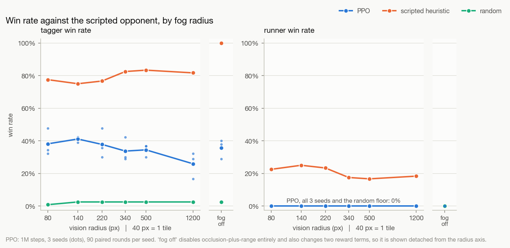
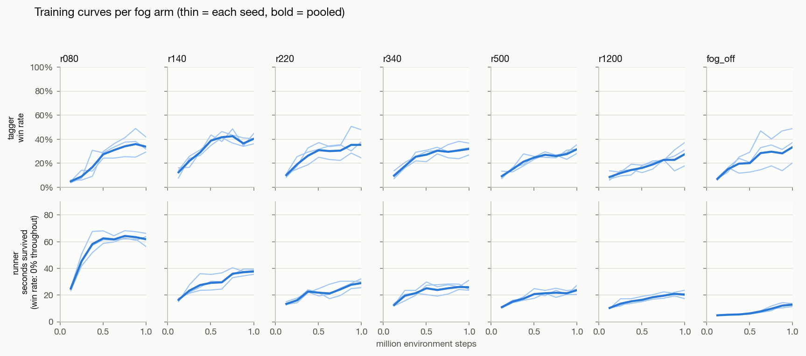
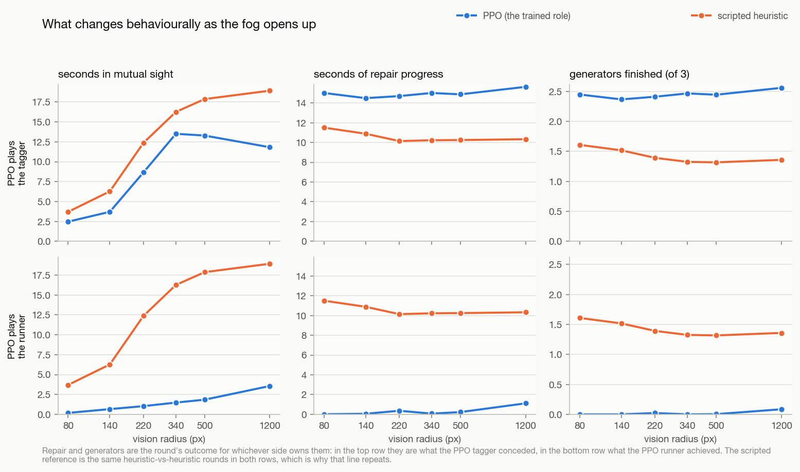
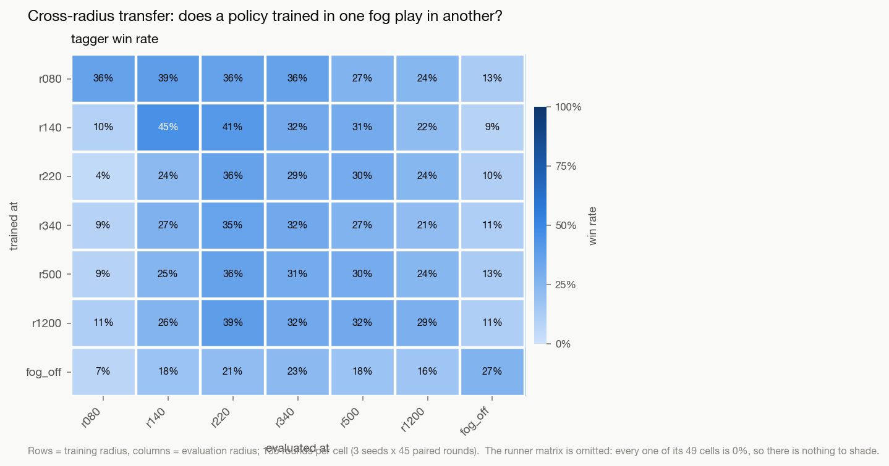
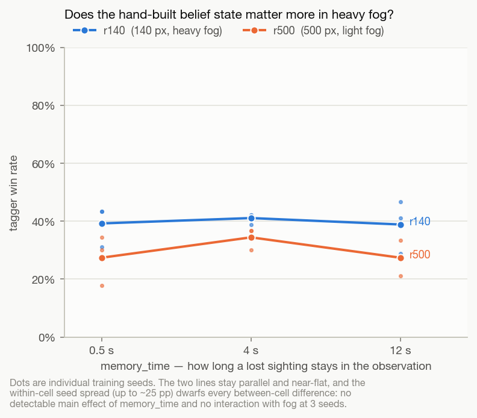

# Fog-of-war ablation — results

> **⚠** 이 스터디는 별도 엔진 계열에서 실행됐다 — 아래의 실행 명령·경로는 그 엔진
> 계열(이 저장소 미포함)에서만 유효하다. 안내: [README.md](README.md).

**Scope.** 54 PPO runs (7 fog arms × 3 seeds × 2 roles, plus a 12-run
memory arm), 1M environment steps each = **54M steps, 13.4 h wall** on 6 cores;
**26,190 evaluated rounds** across 429 paired evaluation cells. Tables:
`results/REPORT.txt`. Figures: `figures/*.png` (light theme only in this repository).

Radius arms are `r080 … r1200` in pixels on 25×15-tile maps (`TILE = 40`, so 80 px
= 2 tiles and the map diagonal is 1166 px). `r220` is the project default.
`fog_off` is reported *detached from the radius axis* throughout — see
[Confounds](#confounds-and-what-this-study-cannot-say).

---

## 1. Fog is two mechanisms, and the radius is the less important one

`vision_radius` moves only one of the two things fog does. Sight is
range-limited **and** walls occlude, and the sweep separates them
(`occlusion_enabled`, added to `GameConfig` with default `True`, so shipped
behaviour is unchanged).

Scripted heuristic-vs-heuristic, runner win rate, 120 rounds per cell:

| radius | both (shipped) | range only | Δ | generators, both | generators, range only |
|---|---|---|---|---|---|
| 80 px | 22.5% | 23.3% | +0.8 | 1.61 | 1.67 |
| 140 px | 25.0% | 12.5% | −12.5 | 1.52 | 1.20 |
| **220 px** | **23.3%** | **2.5%** | **−20.8** | **1.39** | **0.73** |
| 340 px | 17.5% | 0.0% | −17.5 | 1.32 | 0.44 |
| 500 px | 16.7% | 0.0% | −16.7 | 1.32 | 0.26 |
| 1200 px | 18.3% | 0.0% | −18.3 | 1.36 | 0.21 |
| fog off | 0.0% | — | | 0.21 | |

Two things follow.

**With walls occluding, the radius is nearly a free parameter.** Across a 15×
range (80 → 1200 px) the runner's win rate moves 22.5% → 18.3%, non-monotone,
peaking at 140 px. **Without occlusion the radius becomes decisive** — 23.3% → 0%
over the same span. The two mechanisms are substitutes when sight is short (at
80 px a 2-tile circle is its own blindfold, so walls add nothing: Δ = +0.8) and
occlusion carries everything once sight is long.

At the shipped default, removing wall occlusion while keeping the 220 px range
collapses the runner from 23.3% to 2.5%. **The project's fog result rests on
occlusion, not on sight range.**

*Consistency check:* 1200 px with range-only vision reproduces `fog_off` exactly
— 0.0% win, 33.2 s in mutual sight, 0.21 generators against 0.0% / 33.2 s / 0.21.
Two independent code paths, identical numbers.

---

## 2. For the PPO tagger, more vision is worse — at a fixed budget



Tagger win rate, 3 seeds × 90 paired rounds, opponent = the matching heuristic:

| radius | PPO (seed mean ± sd) | per seed | scripted | normalised |
|---|---|---|---|---|
| 80 px | **38.1% ± 8.4** | 48 / 32 / 34 | 78% | 0.49 |
| 140 px | **41.1% ± 1.9** | 39 / 42 / 42 | 75% | 0.53 |
| 220 px | 37.8% ± 9.1 | 36 / 30 / 48 | 77% | 0.48 |
| 340 px | 33.7% ± 7.4 | 42 / 30 / 29 | 82% | 0.39 |
| 500 px | 34.4% ± 3.8 | 30 / 37 / 37 | 83% | 0.40 |
| 1200 px | **25.9% ± 8.2** | 17 / 29 / 32 | 82% | 0.30 |
| fog off | 35.6% ± 5.9 | 40 / 38 / 29 | 100% | 0.34 |

*normalised* rescales PPO onto the random→heuristic interval at that radius:
0 = no better than random, 1 = heuristic parity.

- Win rate vs radius: **Spearman ρ = −0.536, permutation p = 0.023** (n = 18
  seed-level points).
- Normalised score vs radius: **ρ = −0.886, p = 0.033** (n = 6 arm means).

The scripted tagger goes the *other* way (77.5% → 82–83%, and 100% with fog off),
so the like-for-like gap widens monotonically with information:

| radius | 80 | 140 | 220 | 340 | 500 | 1200 | fog off |
|---|---|---|---|---|---|---|---|
| PPO − scripted (paired) | −40.7 | −35.6 | −40.0 | −50.7 | −51.1 | −55.2 | −64.4 |

Every interval excludes zero (e.g. r1200 −55.2 pp, 95% CI [−65.9, −43.7], 90
paired round-cells). **Extra information raises the ceiling and PPO does not
climb it.** The scripted hunter converts sight into denial; PPO does not.

### The caveat that governs this result



Slope over the last 30% of training, percentage points per 100k steps:

| radius | 80 | 140 | 220 | 340 | 500 | 1200 | fog off |
|---|---|---|---|---|---|---|---|
| slope | −1.05 | −0.26 | +1.22 | +2.53 | +0.93 | +1.45 | +2.97 |
| converged? | flat | flat | rising | rising | rising | rising | rising |

The two heavy-fog arms have **plateaued**; every wider arm is **still climbing**
at the 1M cutoff. So the honest claim is about **sample efficiency, not
asymptotes**: heavy fog is markedly faster to learn, and at 1M steps the ranking
is inverted relative to information content. Extrapolating r340's +2.53 pp/100k
would erase its 7 pp deficit to r140 within ~300k further steps. **This ablation
does not establish that wide fog is worse in the limit, and should not be cited
as if it did.**

Why heavy fog might be easier to learn: with a 2-tile sight radius the tagger's
policy collapses to "patrol the objectives", which is a short-horizon,
low-variance behaviour. With wide sight the observation carries a constantly
changing opponent vector, and the useful behaviour — cut off the objective rather
than tail the runner — is a longer-horizon credit-assignment problem.

---

## 3. The tagger sees more and converts less



PPO tagger, seed-pooled:

| radius | seconds in sight | generators conceded | runner survived |
|---|---|---|---|
| 80 px | 2.5 | 2.45 | 47.5 s |
| 220 px | 8.7 | 2.41 | 48.7 s |
| 340 px | 13.5 | 2.47 | 46.9 s |
| 1200 px | 11.8 | 2.56 | 41.7 s |
| fog off | 48.7 | 2.49 | 48.7 s |

Time in sight rises 5× and **generators conceded does not move** (2.41–2.56).
The scripted hunter concedes 1.3–1.6 at every radius. This is the repo's own
"chase versus denial" observation, now measured across the fog axis: PPO's style
is invariant to how much it can see, and its style is the losing one.

PPO's time-in-sight is also *below* the scripted tagger's at every radius
(2.5 vs 3.7 at r080; 11.8 vs 18.9 at r1200) — it is not even maximising the
`SIGHT` shaping term it is paid for.

---

## 4. The runner is at 0% at every fog size — and fog is why it hides

Runner win rate is **0.0% in every arm, every seed** — 1,890 in-distribution
rounds, plus all 49 transfer cells at 0%. Fog size does not rescue the runner.

What fog does control is how well the runner executes the degenerate policy:

| radius | 80 | 140 | 220 | 340 | 500 | 1200 | fog off |
|---|---|---|---|---|---|---|---|
| seconds survived | **62.6** | 43.3 | 31.3 | 24.2 | 27.8 | 22.8 | **13.1** |
| generators | 0.00 | 0.00 | 0.02 | 0.00 | 0.00 | 0.09 | **0.20** |

Survival is monotone in fog and clean across seeds (bottom row of fig. 4);
generators move in the *opposite* direction. At 80 px the runner survives 62.6 s
of a 90 s round while finishing **zero** generators.

The repo already found the runner learns "how to postpone losing rather than how
to win". This locates the cause: **fog is what makes that policy reachable.**
Thicker fog buys more hiding, so hiding dominates harder; remove fog entirely and
hiding stops working (13.1 s survival) and the runner does slightly *more*
repairing (0.20 generators) — but still never wins. The failure is not caused by
fog and is not fixed by removing it; fog only sets which failure mode is
attractive.

---

## 5. Transfer: the extremes are specialisms, the middle is one task



Tagger win rate, rows = training radius, columns = evaluation radius, 135 rounds
per cell:

| train ↓ / eval → | r080 | r140 | r220 | r340 | r500 | r1200 | fog_off | row mean |
|---|---|---|---|---|---|---|---|---|
| **r080** | 36% | 39% | 36% | 36% | 27% | 24% | 13% | **30%** |
| r140 | 10% | **45%** | 41% | 32% | 31% | 22% | 9% | 27% |
| r220 | 4% | 24% | 36% | 29% | 30% | 24% | 10% | 23% |
| r340 | 9% | 27% | 35% | 32% | 27% | 21% | 11% | 23% |
| r500 | 9% | 25% | 36% | 31% | 30% | 24% | 13% | 24% |
| r1200 | 11% | 26% | 39% | 32% | 32% | **29%** | 11% | 26% |
| fog_off | 7% | 18% | 21% | 23% | 18% | 16% | **27%** | 19% |

Is matching train and test radius worth anything?

| eval radius | own-arm | best other arm | Δ |
|---|---|---|---|
| 80 px | 36% | 11% (r1200) | **+24.4** |
| 140 px | 45% | 39% (r080) | +6.7 |
| 220 px | 36% | 41% (r140) | −5.2 |
| 340 px | 32% | 36% (r080) | −4.4 |
| 500 px | 30% | 32% (r1200) | −1.5 |
| 1200 px | 29% | 24% (r080) | +4.4 |
| fog off | 27% | 13% (r080) | **+14.1** |

**Only the two extremes are specialisms.** Near-blind play is a distinct skill
that nothing else transfers into (+24.4 pp), and full information likewise
(+14.1 pp). Across the whole middle of the axis the diagonal is *not* best — a
policy trained at 80 or 140 px plays 220–500 px as well as or better than the
policy trained there. The best row mean belongs to **r080 (30%)** and the worst to
**fog_off (19%)**: training in heavy fog produces the most transferable tagger,
training with no fog the least.

Worth noting for interpretation: `observation.py` contains **no fog-radius
feature**, so a policy cannot condition on the fog it is in. The specialisation
is baked into weights, not selected at run time — and a radius input is a cheap
thing to try if one policy is wanted across all arms.

---

## 6. Two secondary axes: both nulls

**Belief-memory duration × fog.** `memory_time` ∈ {0.5, 4, 12} s at 140 px and
500 px, 3 seeds each.



| radius | 0.5 s | 4 s | 12 s |
|---|---|---|---|
| 140 px | 39.3% ± 7.1 | 41.1% ± 1.9 | 38.9% ± 9.1 |
| 500 px | 27.4% ± 8.6 | 34.4% ± 3.8 | 27.4% ± 6.1 |

Effect of 12 s vs 0.5 s: −0.4 pp at r140, +0.0 pp at r500; **interaction −0.4 pp.**
The hypothesis was that the hand-built belief state should matter more as fog
thickens. It does not measurably matter at all: within-cell seed spread reaches
25 pp, which swamps every between-cell difference. Both rows hint at a peak at
4 s, but at 3 seeds that is not resolvable. **Null result, and the noise floor is
the reason** — not evidence that memory is useless.

**Sampling vs argmax.** The repo's note records 88% sampling vs 33% greedy on a
CLASSIC runner. Per fog level (tagger):

| radius | 80 | 140 | 220 | 340 | 500 | 1200 | fog off |
|---|---|---|---|---|---|---|---|
| argmax − sampling | −3.7 | −2.2 | −6.7 | +0.0 | −5.6 | −0.4 | **−9.3** |

The penalty is real but modest (≈ −4 pp on average) and **does not follow the
fog**: it is largest with *no* fog and zero at 340 and 1200 px. The prediction
that greedy play should hurt most where exploration matters most is not
supported. The dramatic 88 → 33 collapse does not generalise across this axis.

---

## Confounds and what this study cannot say

1. **Changing the radius changes the opponent too.** Fog is symmetric and the
   scripted policies read the world through `can_see`, so every arm is a
   different task *and* a different opponent. Handled by running scripted
   controls at every radius and reporting the paired difference and the
   random→heuristic normalisation; it cannot be removed, only conditioned on.
2. **`fog_off` is not "radius = ∞".** `rl_env.py` gates two reward terms on
   `cfg.fog_enabled`: `SIGHT` is dropped and `CHASE` stops being
   visibility-gated. So that arm changes the training signal as well as the game,
   and it is reported detached from the axis. `r1200` is the controlled ceiling.
   A partial check is the `fog_off` *column* of the transfer matrix, where only
   the evaluation changes: there the fog_off-trained policy scores 27% against
   7–13% for every fog-trained policy, so that specialisation is a real property
   of the weights rather than an artefact of how the arm is scored. What the
   matrix still cannot separate is how much of it came from the changed *game*
   versus the changed *reward* during training.
3. **A reward-scale confound runs along the axis, untested.** `SIGHT` (0.02/s,
   up to +1.8) is easier to earn at large radius, and `CHASE` is
   visibility-gated, so its known oscillation exploit — open distance while
   visible, close it while hidden — is available more often when sight is long.
   This is a plausible mechanism for §2 that this study does not isolate. The
   test is to retrain with `SIGHT = 0` and `CHASE = 0` at r220 and r1200.
4. **3 seeds per cell.** Seed spread is ±2–9 pp (sd), and the r220 arm alone
   spans 30–48%. The *trend* across the axis survives this; individual arm-to-arm
   gaps mostly do not. This is the error the project's own README names as the
   easiest one to make here, so: no single arm-pair difference below ~10 pp
   should be read as real.
5. **1M steps, and the wide arms had not converged** (§2 caveat).
6. **Not covered:** asymmetric fog (per-role radius — `vision_radius` is one
   shared field, so "who does fog favour" cannot be asked without a code change,
   and it is the most interesting question left); an RL arm with
   `occlusion_enabled=False`, which would give the learned-policy version of §1
   directly rather than by inference.

## Reproducing (원 엔진 저장소 기준, 이 저장소에서는 실행 불가)

See `ablation_fog/README.md` in the original engine repository. Everything is resumable and re-running any command
fills only the gaps.

```bash
.venv/bin/python -m ablation_fog.analyze | less   # all tables
.venv/bin/python -m ablation_fog.plots            # all figures
```
